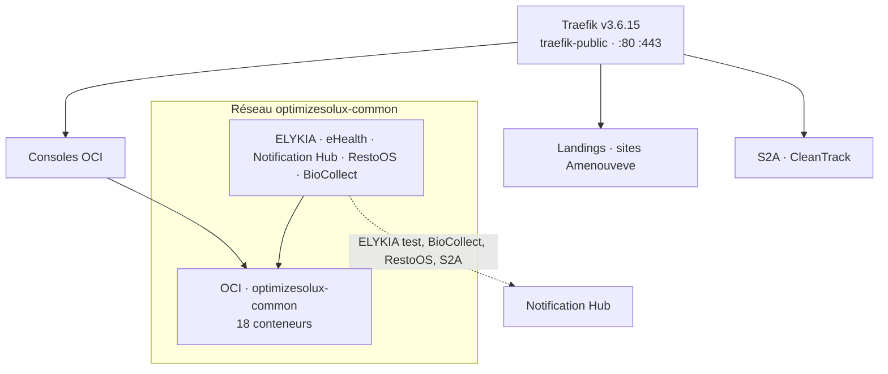

# Architecture Contabo — OCI au centre

Relevé live du **15 octobre 2026** sur `vmi3487219` (8 vCPU, 23 Go RAM, Docker 29.7.1, Ubuntu 24.04).
19 projets Compose, 55 conteneurs, tous running.

Cible fonctionnelle : [SPEC.md](./SPEC.md). Réseaux et ports : [NETWORKING.md](./NETWORKING.md).
Cette page décrit ce qui tourne, y compris les écarts avec la cible.

## Vue d’ensemble

Traefik est le seul processus qui publie 80 et 443. L’OCI (`optimizesolux-common`) est le bus privé : réseau Docker `optimizesolux-common`. Les consoles OCI sortent en HTTPS par Traefik. Les bases métier restent dans chaque produit.

Trait plein vers l’OCI : le conteneur est sur `optimizesolux-common`.
S2A et CleanTrack rejoignent Traefik sans rejoindre ce réseau.

## OCI — profils démarrés

Projet `optimizesolux-common`, chemin `/opt/optimizesolux/common-infra`.
Profils actifs : `core`, `observability`, `mesh`.

| Service | Rôle | Accès |
|---------|------|--------|
| Keycloak 26.2 | Identité | `auth.optimizesolux.com` |
| keycloak-db | Postgres des realms | réseau commun |
| Redis 7 | Cache partagé | `redis:6379` |
| Artemis 2.40 | Broker | `artemis:61616`, console `artemis.optimizesolux.com` |
| MinIO | Objets S3 | `minio:9000`, `s3.optimizesolux.com`, `s3-console.optimizesolux.com` |
| Vault 1.17 | Secrets | `vault:8200`, `vault.optimizesolux.com` |
| Mailpit | SMTP de test | `mailpit:1025`, `mail.optimizesolux.com` |
| pgAdmin | Consoles SQL | `pgadmin.optimizesolux.com` |
| Eureka + Gateway | Découverte | `eureka.optimizesolux.com`, `gateway.optimizesolux.com` |
| OTel collector | Traces OTLP | `otel-collector:4318` |
| Prometheus | Métriques | `prometheus.optimizesolux.com` |
| Grafana | Tableaux | `grafana.optimizesolux.com` |
| Loki + Promtail | Journaux | réseau commun |
| node-exporter, cAdvisor, redis-exporter | Métriques hôte et conteneurs | réseau commun |

Profils présents dans le compose, non démarrés : `kafka`, `rabbitmq`, `tracing` (Jaeger), `ai` (Ollama).

Realms dans l’image Keycloak : `biocollect`, `cleantrack`, `ehealth`, `impactc`, `notification-hub`, `optimizesolux`, `restoos`.
`impactc` et `optimizesolux` n’ont pas de stack produit déployée. Le realm `cleantrack` de l’image n’est pas l’émetteur utilisé par CleanTrack (voir plus bas).

## Qui consomme l’OCI

| Produit | Keycloak | Redis | Autre OCI | Reste dans le produit |
|---------|----------|-------|-----------|------------------------|
| ELYKIA prod / test | — | — | MinIO, OTel | Postgres 15 |
| eHealth | realm `ehealth` | — | OTel | Postgres |
| Notification Hub | realm `notification-hub` | base 1 | Artemis, OTel | Postgres 16, Resend, Brevo |
| RestoOS | realm `restoos` | base 9 | OTel | Postgres 16 |
| BioCollect | realm `biocollect` | — | réseau commun | MySQL 8.4 |
| S2A | NextAuth local | — | — | Postgres local |
| CleanTrack | Keycloak dédié | Redis dédié | — | Postgres dédié |
| Landings et sites | — | — | — | nginx + Traefik |

Le courrier du Notification Hub sort par Resend (`smtp.resend.com:465`) et l’API Brevo. Mailpit sert de catcher SMTP sur l’OCI ; ce n’est pas le chemin d’envoi du hub.

### ELYKIA

Stacks `elykia-prod` et `elykia-test` (`/opt/elykia/deploy`) : API, frontend, Postgres. Les backends sont sur `optimizesolux-common`.

- Hôtes : `elykia.amenouveve-yaveh.com`, `elykia-test.amenouveve-yaveh.com`
- MinIO : `http://minio:9000`, URL publique `https://s3.optimizesolux.com` (buckets `elykia-*`, suffixe `-test` en test)
- OTel : `http://otel-collector:4318` (`elykia-api`, `elykia-api-test`)
- Hub : `http://notification-hub-prod-api-1:8088`. Envoi désactivé en prod, actif en test.

Le site et l’espace client sont des stacks à part, uniquement sur `traefik-public` :

| Stack | Hôte |
|-------|------|
| `website-prod` | `www.amenouveve-yaveh.com` (redirection de l’apex) |
| `website-test` | `site.amenouveve-yaveh.com` |
| `customer-space-prod` | `clients.amenouveve-yaveh.com` |
| `customer-space-test` | `clients-test.amenouveve-yaveh.com` |
| `elykia-landing` | `elykia.optimizesolux.com` |

### eHealth

Stack `ehealth-prod` (`/opt/ehealth/deploy`), réseau commun : frontend, EMPI `:8081`, GAP `:8082`, DPI `:8083`, tenant `:8084`, Postgres.

Les quatre services Java valident `https://auth.optimizesolux.com/realms/ehealth` et envoient leurs traces à l’OTel collector. Le tenant appelle Keycloak en interne (`http://keycloak:8080`).

Le frontend et la landing `ehealth-landing` déclarent tous les deux `ehealth.optimizesolux.com`. La landing porte la priorité Traefik 10.

### Notification Hub

Stack `notification-hub-prod` (`/opt/notification-hub/deploy`) : API `:8088`, frontend, Postgres 16.

- `notification.optimizesolux.com`, `notification-api.optimizesolux.com`
- Redis base 1, Artemis `tcp://artemis:61616`, realm `notification-hub`, OTel

ELYKIA test, BioCollect, RestoOS et S2A l’appellent. BioCollect, RestoOS et S2A passent par `https://notification-api.optimizesolux.com`. ELYKIA passe par le DNS Docker du conteneur.

### RestoOS

Stack `restoos-prod` (`/opt/restoos/deploy`) : API, frontend, Postgres 16. Hôte `restoos.optimizesolux.com` (UI, `/api`, `/ws`).

Realm `restoos`, Redis OCI base 9, OTel. Le hub est appelé en HTTPS public.

### BioCollect

Stack `biocollect-prod` (`/opt/biocollect/deploy`) : app `:3000` et MySQL 8.4, les deux sur le réseau commun. Hôte `biocollect.optimizesolux.com`. Realm `biocollect`. Le hub est appelé en HTTPS public.

### Landings

Cinq nginx, uniquement sur `traefik-public` :

| Stack | Hôte |
|-------|------|
| `bcms-landing` | `bcms.optimizesolux.com` |
| `ehealth-landing` | `ehealth.optimizesolux.com` |
| `elykia-landing` | `elykia.optimizesolux.com` |
| `scalebio-landing` | `scalebio.optimizesolux.com` et chemin `/` |
| `stackpilot-landing` | `stackpilot.optimizesolux.com` |

StackPilot utilise le resolver TLS `le`. Les autres utilisent `letsencrypt`.

### S2A

Stack `s2a` (`/opt/optimizesolux/s2a`) : app et Postgres sur `s2a_s2a-internal`. Hôte `s2a.optimizesolux.com`. NextAuth local. Seul lien applicatif vers la plateforme : le Notification Hub en HTTPS public.

### CleanTrack

Stack `cleantrack-prod` (`/opt/cleantrack/deploy`), réseau `cleantrack-prod-internal` : API, frontend, Postgres, Redis, Keycloak dédié. Aucun conteneur sur `optimizesolux-common`.

Hôtes : `cleantrack.optimizesolux.com`, `cleantrack-api.optimizesolux.com`, `cleantrack-auth.optimizesolux.com`.

## Projets Compose

| Projet | Conteneurs | Chemin | Réseaux |
|--------|------------|--------|---------|
| `optimizesolux-common` | 18 | `/opt/optimizesolux/common-infra` | commun + `traefik-public` |
| `traefik` | 1 | `/opt/optimizesolux/traefik` | `traefik-public` |
| `elykia-prod` | 3 | `/opt/elykia/deploy` | commun + interne + public |
| `elykia-test` | 3 | `/opt/elykia/deploy` | commun + interne + public |
| `ehealth-prod` | 6 | `/opt/ehealth/deploy` | commun + public |
| `notification-hub-prod` | 3 | `/opt/notification-hub/deploy` | commun + public |
| `restoos-prod` | 3 | `/opt/restoos/deploy` | commun + interne + public |
| `biocollect-prod` | 2 | `/opt/biocollect/deploy` | commun + public |
| `s2a` | 2 | `/opt/optimizesolux/s2a` | `s2a-internal` + public |
| `cleantrack-prod` | 5 | `/opt/cleantrack/deploy` | interne + public |
| landings (5) | 5 | `/opt/optimizesolux/*-landing` et `stackpilot-landing` | `traefik-public` |
| sites Amenouveve (4) | 4 | `/opt/elykia/deploy` | `traefik-public` |

## Écarts avec la cible

- CleanTrack embarque encore son Redis et son Keycloak. L’auth live est `cleantrack-auth.optimizesolux.com`.
- eHealth app et landing partagent `ehealth.optimizesolux.com` ; la landing a la priorité Traefik 10.
- Les realms `impactc` et `optimizesolux` sont dans l’image Keycloak sans produit déployé.
- S2A appelle le hub via l’URL publique, hors réseau `optimizesolux-common`.
